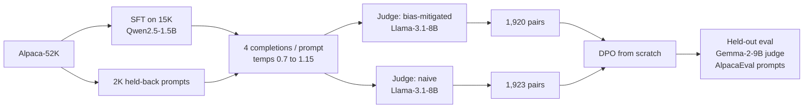

# Bias-Audited SFT + DPO for Instruction Following

An end-to-end post-training study on **Qwen2.5-1.5B**: SFT and DPO implemented from scratch (custom losses, no library trainers), preference labels produced by an LLM judge that was **validated against human annotations before being trusted**, and downstream results evaluated with confidence intervals and a length-stratified check rather than a single win-rate number.

> **Status:** active research project. Phases 0 to 5 are complete, including the learning-rate sweep and a head-to-head test of the two labeling methods. Remaining work: a second seed at LR = 5e-6 (in progress), LR above 5e-6, then dataset scale and epoch count, each run in isolation. See [Status and next steps](#status-and-next-steps).

---

## TL;DR

- Implemented **SFT** (response-only loss masking) and **DPO** (summed response log-probs, frozen reference model) from scratch in PyTorch.
- Built a **bias-aware LLM-judge labeling pipeline** (position randomization, explicit length control, CoT rubric) and validated it against the human-annotated AlpacaFarm cross-annotations with a pre-set threshold, a diagnosed failure mode, and a stopping rule.
- Three **distinct model families** fill the three roles (policy / labeling judge / eval judge) to avoid self-preference bias.
- **First result was null:** at LR = 1e-6, none of four DPO configurations beat SFT in-distribution (all win-rates 48 to 50%, CIs include 50%).
- **A controlled LR sweep found the cause.** With LR as the only changed variable, the bias-mitigated config at **LR = 5e-6** beat SFT on held-out prompts. Under both-order judging (a pair counts only if the judge prefers the same response in both orders), it won **64 vs. 27** decisive pairs in-distribution (p = 0.0001) and **33 vs. 6** under distribution shift (p < 0.0001). Counting split verdicts as half, that is **57.4%** and **63.5%**. It wins at least as often when its answer is not longer than SFT's, which argues against a length-driven gain. One seed.
- **The LR effect appears for both label types, more weakly for naive.** At 1e-6 and 2e-6 neither policy is reliably ahead of SFT. At 5e-6 the mitigated policy is ahead on both slices; the naive policy is ahead only under shift (in-dist 55 vs. 45 decisive pairs, p = 0.37).
- **Label debiasing did not measurably change quality.** A head-to-head of the mitigated and naive 5e-6 policies (each pair judged in both orders) found no detectable difference. Two-thirds of pairs were position-dependent ties, and among decisive pairs the mitigated policy won 56.0% in-dist (CI [45.3, 66.1]) and 42.9% under shift (CI [28.0, 59.1]). The test was underpowered (119 decisive pairs; about 540 needed to detect a 56% effect), so this is "not detected", not "no effect".
- **Label debiasing did change verbosity.** The naive-label policy's answer was longer than the mitigated policy's in about 85% (in-dist) and 78% (shift) of pairs. Against SFT, the naive policy's answer was longer in 79% / 83% of pairs, vs. 63% / 71% for mitigated. One seed per config; this describes length, not quality.
- **The eval judge has a strong position bias** (it picked the first-shown response about 75% of the time when comparing two similar policies), which only became visible when scoring both orders.

---

## Key results

### Held-out win-rate vs. the SFT baseline

Judge: Gemma-2-9B-it (CoT rubric, position-randomized, one judgment per prompt). 95% Wilson intervals. These single-order numbers are noisy because of the judge's position bias; the position-controlled result for the 5e-6 policies is in [Both-order re-scoring](#both-order-re-scoring-of-the-5e-6-policies-vs-sft). "In-dist" = 252 AlpacaEval `selfinstruct` prompts; "shift" = 100 prompts stratified across `oasst`, `koala`, `helpful_base`, `vicuna`.

| DPO config | LR | In-dist win-rate | 95% CI | Shift win-rate | 95% CI |
|---|---|---|---|---|---|
| mitigated labels, β=0.05 | 1e-6 | 47.8% | [41.7, 54.0] | 51.0% | [41.3, 60.6] |
| mitigated labels, β=0.1 | 1e-6 | 48.0% | [41.8, 54.2] | 56.0% | [46.2, 65.3] |
| mitigated labels, β=0.3 | 1e-6 | 49.6% | [43.4, 55.8] | 55.0% | [45.2, 64.4] |
| naive labels, β=0.1 | 1e-6 | 49.6% | [43.4, 55.8] | 61.0% | [51.2, 70.0] |
| mitigated labels, β=0.1 | 2e-6 | 47.8% | [41.7, 54.0] | 55.0% | [45.2, 64.4] |
| naive labels, β=0.1 | 2e-6 | 50.0% | [43.8, 56.2] | 54.0% | [44.3, 63.4] |
| **mitigated labels, β=0.1** | **5e-6** | **59.4%** | **[53.2, 65.3]** | **68.0%** | **[58.3, 76.3]** |
| naive labels, β=0.1 | 5e-6 | 53.8% | [47.6, 59.8] | 65.0% | [55.3, 73.6] |

At LR = 1e-6 and 2e-6, only one of twelve comparisons (naive labels at 1e-6, shift slice) excluded 50%, and it only partially survived the length check below. At LR = 5e-6, the mitigated policy excludes 50% on both slices; the naive policy excludes it on the shift slice only. The two label types track each other across LR, and their 5e-6 intervals overlap heavily (see the head-to-head below). One seed per cell.

### Length-stratified check (LR = 5e-6, mitigated, β=0.1)

AlpacaEval's regression-based length-controlled metric was out of scope, so length is checked by stratification: win-rate split by whether the DPO response is longer than the SFT response for the same prompt.

| Slice | DPO response longer | DPO response not longer |
|---|---|---|
| In-dist | 58.0% (n=157), CI [50.2, 65.4] | 62.0% (n=92), CI [51.8, 71.2] |
| Shift | 66.2% (n=71), CI [54.6, 76.1] | 72.4% (n=29), CI [54.3, 85.3] |

The policy wins at least as often when its answer is **not** longer. That is the opposite of what a length-driven gain would look like. (The shift/not-longer cell is small, n=29.)

For comparison, the same check on the **naive-label** 5e-6 policy:

| Slice | DPO response longer | DPO response not longer |
|---|---|---|
| In-dist | 52.5% (n=198), CI [45.6, 59.4] | 58.5% (n=53), CI [45.1, 70.7] |
| Shift | 61.4% (n=83), CI [50.7, 71.2] | 82.4% (n=17), CI [59.0, 93.8] |

The two label types differ in how often the DPO answer is longer than the SFT answer: **63% in-dist and 71% shift for mitigated, vs. 79% and 83% for naive.** The in-dist difference (about 16 points) is large relative to its standard error; the shift difference (about 12 points) is closer to the noise. The naive shift/not-longer cell has only 17 pairs and should not be read.

### Training dynamics (reward accuracy on the training pairs)

| Run | LR | Reward acc, first half → second half | Loss, first half → second half |
|---|---|---|---|
| mitigated, β=0.1 | 1e-6 | 0.500 → 0.521 | 0.6918 → 0.6907 (flat) |
| mitigated, β=0.1 | 2e-6 | 0.562 → 0.698 | 0.6875 → 0.6773 |
| mitigated, β=0.1 | 5e-6 | 0.630 → 0.792 | 0.6728 → 0.6098 |
| naive, β=0.1 | 1e-6 | 0.625 → 0.745 | 0.6852 → 0.6742 |
| naive, β=0.1 | 2e-6 | 0.745 → 0.828 | 0.6644 → 0.6266 |
| naive, β=0.1 | 5e-6 | 0.760 → 0.844 | 0.5866 → 0.4686 |
| mitigated, β=0.05 | 1e-6 | 0.521 → 0.562 | 0.6927 → 0.6910 |
| mitigated, β=0.3 | 1e-6 | 0.521 → 0.599 | 0.6911 → 0.6828 |

Training reward accuracy is measured against noisy judge labels, so it is **not** a quality metric. It is used only as a diagnostic. Held-out evaluation is the evidence. (Values are means over the 24 logged windows in each half of training. At every LR, the naive-label run reaches higher training accuracy than the mitigated run, which is consistent with, but does not demonstrate, naive labels containing an easier shortcut such as "longer is better".)

### Both-order re-scoring of the 5e-6 policies vs. SFT

The 5e-6 policies were re-scored against SFT with every pair judged in both orders (`--both_orders`). A win requires winning in both orders, and a split verdict is a tie. Ties are 60 to 63% of pairs. The first-shown response was picked 77 to 80% of the time.

| Policy | Slice | Wins / losses / ties | Decisive win-rate (95% CI) | Sign-test p | Ties counted as 0.5 |
|---|---|---|---|---|---|
| mitigated | In-dist | 64 / 27 / 158 | 70.3% [60.3, 78.7] | 0.0001 | 57.4% |
| mitigated | Shift | 33 / 6 / 61 | 84.6% [70.3, 92.8] | <0.0001 | 63.5% |
| naive | In-dist | 55 / 45 / 151 | 55.0% [45.2, 64.4] | 0.37 | 52.0% |
| naive | Shift | 31 / 9 / 60 | 77.5% [62.5, 87.7] | 0.0007 | 61.0% |

- **The 5e-6 improvement over SFT survives position-bias control.** When the judge has a position-independent preference, it favors the mitigated policy over SFT by 64:27 in-dist and 33:6 under shift. The "ties as 0.5" column (57.4%, 63.5%) is close to the single-order numbers (59.4%, 68.0%), as expected, since ties pull it toward 50% by construction. The two columns answer different questions and should not be compared as if they were the same metric.
- **The decisive-only rate conditions on the judge agreeing with itself across orders,** which drops about 60% of the pairs. It describes pairs with a clear preference and does not describe the whole eval set.
- **Naive in-dist is the one cell that does not clear 50%** (55:45, p = 0.37). The mitigated-vs-naive gap in-dist (70.3% vs. 55.0% against SFT) looks large, but it compares two different, non-paired subsets of decisive pairs. The direct head-to-head below is the proper test, and it found no significant difference. Do not cite this indirect gap as evidence for mitigation.
- Length-split win-rates (ties as 0.5): mitigated wins 55.4% when longer vs. 60.9% when not longer in-dist, and 60.6% vs. 70.7% under shift. The policy still does at least as well when its answer is shorter.

### Head-to-head: mitigated vs. naive labels (LR = 5e-6, β = 0.1)

Comparing each policy to SFT separately cannot show whether the two labeling methods differ. So the two policies were scored directly against each other. Each pair is judged in **both orders**; a policy gets a win only if it wins in both, and a split verdict counts as a tie (the judge's preference followed position, not content).

| Slice | Mitigated wins | Naive wins | Ties | Mitigated win-rate among decisive pairs | Sign-test p |
|---|---|---|---|---|---|
| In-dist (n=251) | 47 | 37 | 167 (66.5%) | 56.0%, CI [45.3, 66.1] | 0.33 |
| Shift (n=100) | 15 | 20 | 65 (65.0%) | 42.9%, CI [28.0, 59.1] | 0.50 |
| Pooled | 62 | 57 | 232 | 52.1%, CI [43.2, 60.9] | 0.71 |

- **No detectable quality difference.** Both intervals include 50%, the direction flips between slices, and only 119 of 351 pairs were decisive. At this effect size (about 56% vs. 50%), roughly 540 decisive pairs would be needed for 80% power, which this eval set cannot supply, so the question is not resolvable here.
- **Strong position bias.** The eval judge picked the first-shown response 75.3% (in-dist) and 76.5% (shift) of the time. Random A/B assignment in the earlier SFT-vs-DPO scoring cancels this on average but adds noise, and likely pulls those win-rates toward 50%. This was not measured for those runs.
- **Length.** The mitigated policy's answer was longer than the naive policy's in only 14.7% (in-dist) and 22.0% (shift) of pairs. Win-rates split by length are not interpretable (the mitigated-longer cells have n=16 and n=8).

---

## Pipeline



**Three roles, three model families**, so no model judges its own family's outputs:

| Role | Model |
|---|---|
| Policy (SFT, DPO) | Qwen2.5-1.5B |
| Labeling judge (builds DPO pairs) | Llama-3.1-8B-Instruct |
| Eval judge (scores SFT vs. DPO) | Gemma-2-9B-it |

---

## Design decisions worth reading

**Judge validation before use.** The labeling judge was validated on the `reward` split of the AlpacaFarm human cross-annotations (Alpaca-sourced, matching the prompts it would label). The eval judge was validated on the `eval` split (AlpacaEval-sourced, matching what it would score). The pass/fail thresholds were set before running the pilot.

| Judge config (labeling judge, n=250) | Agreement with human majority |
|---|---|
| Zero-shot forced choice | 59.6%, but with a positional skew (agreement 66.9% when humans preferred output 2, 50.5% when they preferred output 1) |
| CoT + few-shot, v1 | 56.4%, skew removed, but over-weighted minor technical compliance |
| **CoT + few-shot, v2 (shipped)** | **57.2%**, skew removed, agreement even across both directions (56.8% / 57.6%) |
| Human-human ceiling on this split | 64.2% (leave-one-out) |

The shipped judge scored below the pre-set 60% threshold. It was shipped anyway as a documented exception: the zero-shot judge's higher number came from an exploitable positional bias, and the split's own human ceiling is only 64.2%. Iteration stopped after two rounds, because tuning further against the same fixed 250-pair set risks overfitting the rubric to it. Gemma-2-9B-it as eval judge scored 63.7% against a 67.2% human ceiling on its split and was used without further tuning.

**Pair construction.** Best and worst of four completions are found with a 4-comparison min-max tournament (pair up, compare winners, compare losers), cheaper than six pairwise comparisons. Pairs where chosen and rejected are textually identical are dropped.

**Controlled labeling ablation.** The "naive" and "mitigated" datasets are built from the *same* completions. The naive judge is a bare forced-choice prompt in fixed order with no length instruction. Only the labeling method differs.

**One variable at a time.** The LR sweep changed LR and nothing else. Dataset size and epoch count were deliberately held fixed so the result stays interpretable.

---

## Training details

**SFT.** Full fine-tuning, bf16, AdamW, LR 2e-5 (cosine, 4% warmup), effective batch 32, 2 epochs, max length 1024. Prompt tokens are masked with `-100`; EOS is appended as a token id. 5% of the 15K subsample is held out for eval loss, and the best-eval-loss checkpoint is kept (epoch 1: 1.232 vs. epoch 2: 1.233, i.e. no gain from the second epoch).

**DPO.** Custom PyTorch loop. Loss is `-log σ(β · ((logπ_θ(y_w) − logπ_θ(y_l)) − (logπ_ref(y_w) − logπ_ref(y_l))))` with un-normalized summed log-probs over response tokens only. Reference model is a frozen copy of the SFT checkpoint. AdamW, cosine schedule with 10% warmup, batch 8, 2 epochs, grad-clip 1.0. Reward margins and reward accuracy are logged every 10 steps to `training_metrics.json`.

**Evaluation.** Greedy decoding (max 256 new tokens). In the SFT-vs-DPO scoring, each pair is judged once per prompt with randomized A/B position. The DPO-vs-DPO head-to-head judges every pair in both orders (see above), and `phase5c_score_eval.py` supports the same with `--both_orders`. Intervals are Wilson score intervals; the head-to-head also reports an exact sign test.

---

## Limitations

Please read these before citing any number above.

- **Single training run per configuration.** Seed-to-seed variance is not measured. The 5e-6 result in particular comes from one run.
- **LR was selected on the eval prompts.** The sweep picked 5e-6 using the same held-out prompts the results are reported on, which biases the best cell upward. Two things make a pure selection artifact less likely: the naive-label sweep shows the same jump at 5e-6 on the shift slice without being tuned separately, and the mitigated 5e-6 both-order sign-test p-values (0.0001 and <0.0001) are below 0.05/16, a Bonferroni threshold for the 16 sweep comparisons (8 configs x 2 slices; only the 5e-6 policies were scored in both orders, so this is a rough guide, not a formal correction). The trend across LR is not monotone (for example, mitigated in-dist is 48.0%, 47.8%, then 59.4%), so do not describe it as a smooth scaling curve. A confirmation run on fresh prompts, or a second seed, would close this.
- **Eval-judge position bias.** The eval judge picks the first-shown response 75 to 80% of the time. Single-order scoring (used for the main SFT-vs-DPO tables) is noisy because of this. The 5e-6 policies were re-scored with both-order judging and the improvement over SFT held, but only 37 to 40% of pairs are decisive, so those intervals are conditional on judge agreement. The other LR and beta configs were not re-scored.
- **One eval judge.** The eval judge shares its CoT rubric with the labeling judge (different model family, same criteria), so the two are not fully independent in what they reward. A second, independently designed judge would be a stronger check, and no human evaluation of the final policies was done.
- **Judge reliability is below the human ceiling** (57.2% vs. 64.2% for the labeling judge), so a meaningful share of training labels is noisy.
- **Small data.** About 1.9K DPO pairs; 100 prompts in the shift slice (the length-stratified shift cells are as small as n=29).
- **Length control is a stratified check, not a regression.** It is a transparent robustness test, not a replacement for AlpacaEval's length-controlled metric.
- **Spot-check is weak evidence.** A 25-item single-annotator spot-check (72% agreement, CI roughly 54 to 90%) used best-vs-worst pairs, which are easier than typical pairs. It is a sanity check, not validation.
- **The naive-vs-mitigated question is unresolved at this scale.** The head-to-head found no detectable difference in quality, but with 65 to 67% ties it had little power. "Label debiasing does not change quality" is not established; only "no difference was detected, and it would take far more pairs to detect a small one".
- **The length difference between label types is one seed per config** and is a description of response length, not evidence about quality.
- Results are specific to this model size, dataset, and judge setup.

---

## Status and next steps

- [x] Phase 0: data prep, split verification (no overlap between SFT, DPO prompts, and eval)
- [x] Phase 1: SFT
- [x] Phase 2: labeling-judge validation and spot-check
- [x] Phase 3: completion generation and dual (mitigated / naive) labeling
- [x] Phase 4: DPO training (4 configs at LR 1e-6, plus LR sweep on mitigated)
- [x] Phase 5: eval-judge validation and held-out evaluation
- [x] LR sweep on mitigated labels (1e-6, 2e-6, 5e-6) with held-out evaluation
- [x] LR sweep on naive labels (1e-6, 2e-6, 5e-6) with held-out evaluation
- [x] Both-order re-scoring of the two 5e-6 policies vs. SFT (improvement holds; other configs not re-scored)
- [x] Head-to-head of mitigated vs. naive at 5e-6 (both-order judging): no detectable quality difference
- [ ] Second seed at 5e-6 for both label types (in progress)
- [ ] LR above 5e-6 (the best result is at the edge of the grid)
- [ ] Optional: larger preference dataset, then epoch count (each run in isolation)

---

## Repository layout

```
phase0_data_prep.py              # Alpaca split, AlpacaEval + cross-annotation download
phase0_closeout_checks.py        # eval-leakage check, gated-model access check
phase1_sft_train.py              # SFT with custom response-only loss masking
phase2_judge_pilot.py            # labeling-judge validation vs. human annotations
phase2_spotcheck_prepare.py      # blinded self-labeling sheet
phase2_spotcheck_score.py        # score the spot-check
phase3a_generate_completions.py  # 4 completions per prompt from the SFT model
phase3b_label_pairs.py           # mitigated + naive labeling via min-max tournament
phase4_dpo_train.py              # DPO from scratch (--lr, --beta, --pairs_path)
phase5a_eval_judge_pilot.py      # eval-judge validation
phase5b_prepare_eval_split.py    # in-dist / shift slices of AlpacaEval
phase5b_generate_eval_completions.py
phase5c_score_eval.py            # SFT-vs-DPO scoring, win-rate + length strata (--both_orders optional)
score_h2h.py                     # DPO-vs-DPO head-to-head, both-order judging, sign test
slurm/                           # example Slurm job scripts (cluster-specific)
```

---

## Reproducing

```bash
# environment: PyTorch (CUDA), transformers, datasets, huggingface_hub, accelerate
huggingface-cli login            # Llama-3.1 and Gemma-2 are gated: accept licenses first

python phase0_data_prep.py
python phase0_closeout_checks.py
python phase1_sft_train.py
python phase2_judge_pilot.py
python phase3a_generate_completions.py
python phase3b_label_pairs.py

python phase4_dpo_train.py --pairs_path data/phase3_dpo_pairs_mitigated.json \
    --beta 0.1 --lr 5e-6 --output_dir checkpoints/dpo_mitigated_beta0.1_lr5e-6

python phase5b_prepare_eval_split.py
python phase5b_generate_eval_completions.py --checkpoint_path checkpoints/qwen2.5-1.5b-sft/final_sft_checkpoint --checkpoint_name sft
python phase5b_generate_eval_completions.py --checkpoint_path checkpoints/dpo_mitigated_beta0.1_lr5e-6 --checkpoint_name dpo_mitigated_beta0.1_lr5e-6
python phase5c_score_eval.py --dpo_checkpoint_name dpo_mitigated_beta0.1_lr5e-6 --slice indist
python phase5c_score_eval.py --dpo_checkpoint_name dpo_mitigated_beta0.1_lr5e-6 --slice genshift

# head-to-head (needs completions for both checkpoints; naive uses --pairs_path data/phase3_dpo_pairs_naive.json)
python score_h2h.py --a dpo_mitigated_beta0.1_lr5e-6 --b dpo_naive_beta0.1_lr5e-6
```

Developed on a single H100 (80 GB). Large files (`data/`, `checkpoints/`) are not committed.

### Version notes (transformers v5 era)

These cost real debugging time, so they are recorded here:

- `TrainingArguments`: `warmup_ratio` was removed; use `warmup_steps` with a float (it acts as a ratio).
- `from_pretrained`: `torch_dtype` is deprecated in favor of `dtype`.
- `apply_chat_template` now returns a `BatchEncoding` by default; pass `return_dict=True` and unpack with `**inputs` into `generate()`.
- `datasets` 4.0+ no longer supports script-based datasets; `tatsu-lab/alpaca_eval` must be fetched as raw JSON via `hf_hub_download`.
- Qwen2.5-1.5B ties embeddings, so a "missing keys: lm_head.weight" warning on checkpoint reload is cosmetic (tie verified directly).
- Batched generation needs `padding_side="left"`; the SFT/DPO label-aligned collators need `padding_side="right"`.

---

## References

- Rafailov et al., *Direct Preference Optimization: Your Language Model is Secretly a Reward Model* (2023)
- Dubois et al., *AlpacaFarm* (2023) and the AlpacaEval project (human cross-annotations used for judge validation)
- Zheng et al., *Judging LLM-as-a-Judge with MT-Bench and Chatbot Arena* (2023) (position and verbosity bias)

## License and data

Code: add your preferred license here. Datasets and models (Alpaca, AlpacaEval, Qwen2.5, Llama-3.1, Gemma-2) are subject to their own licenses and terms; check them before redistributing any derived data or weights.

## Author

Ankit Sharma, [GitHub / LinkedIn / email]
