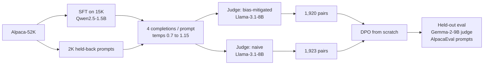

# Bias-Audited SFT + DPO for Instruction Following

An end-to-end post-training study on **Qwen2.5-1.5B**: SFT and DPO implemented from scratch (custom losses, no library trainers), preference labels produced by an LLM judge that was **validated against human annotations before being trusted**, and downstream results evaluated with confidence intervals and a length-stratified check rather than a single win-rate number.

> **Status:** active research project. Phases 0 to 5 are complete; one follow-up (re-running the labeling-method ablation at the corrected learning rate) is in progress. See [Status and next steps](#status-and-next-steps).

---

## TL;DR

- Implemented **SFT** (response-only loss masking) and **DPO** (summed response log-probs, frozen reference model) from scratch in PyTorch.
- Built a **bias-aware LLM-judge labeling pipeline** (position randomization, explicit length control, CoT rubric) and validated it against the human-annotated AlpacaFarm cross-annotations with a pre-set threshold, a diagnosed failure mode, and a stopping rule.
- Three **distinct model families** fill the three roles (policy / labeling judge / eval judge) to avoid self-preference bias.
- **First result was null:** at LR = 1e-6, none of four DPO configurations beat SFT in-distribution (all win-rates 48 to 50%, CIs include 50%).
- **A controlled LR sweep found the cause.** With LR as the only changed variable, the bias-mitigated config at **LR = 5e-6** beat SFT on held-out prompts: **59.4%** in-distribution (95% CI [53.2, 65.3]) and **68.0%** under distribution shift (95% CI [58.3, 76.3]), with no sign of length exploitation.

---

## Key results

### Held-out win-rate vs. the SFT baseline

Judge: Gemma-2-9B-it (CoT rubric, position-randomized). 95% Wilson intervals. "In-dist" = 252 AlpacaEval `selfinstruct` prompts; "shift" = 100 prompts stratified across `oasst`, `koala`, `helpful_base`, `vicuna`.

| DPO config | LR | In-dist win-rate | 95% CI | Shift win-rate | 95% CI |
|---|---|---|---|---|---|
| mitigated labels, β=0.05 | 1e-6 | 47.8% | [41.7, 54.0] | 51.0% | [41.3, 60.6] |
| mitigated labels, β=0.1 | 1e-6 | 48.0% | [41.8, 54.2] | 56.0% | [46.2, 65.3] |
| mitigated labels, β=0.3 | 1e-6 | 49.6% | [43.4, 55.8] | 55.0% | [45.2, 64.4] |
| naive labels, β=0.1 | 1e-6 | 49.6% | [43.4, 55.8] | 61.0% | [51.2, 70.0] |
| **mitigated labels, β=0.1** | **5e-6** | **59.4%** | **[53.2, 65.3]** | **68.0%** | **[58.3, 76.3]** |

At LR = 1e-6, only one of eight comparisons (naive labels, shift slice) excluded 50%, and it only partially survived the length check below. At LR = 5e-6, both slices exclude 50%.

### Length-stratified check (LR = 5e-6, mitigated, β=0.1)

AlpacaEval's regression-based length-controlled metric was out of scope, so length is checked by stratification: win-rate split by whether the DPO response is longer than the SFT response for the same prompt.

| Slice | DPO response longer | DPO response not longer |
|---|---|---|
| In-dist | 58.0% (n=157), CI [50.2, 65.4] | 62.0% (n=92), CI [51.8, 71.2] |
| Shift | 66.2% (n=71), CI [54.6, 76.1] | 72.4% (n=29), CI [54.3, 85.3] |

The policy wins at least as often when its answer is **not** longer. That is the opposite of what a length-driven gain would look like. (The shift/not-longer cell is small, n=29.)

### Training dynamics (reward accuracy on the training pairs)

| Run | LR | Reward acc, first half → second half | Loss, first half → second half |
|---|---|---|---|
| mitigated, β=0.1 | 1e-6 | 0.500 → 0.521 | 0.6918 → 0.6907 (flat) |
| mitigated, β=0.1 | 2e-6 | 0.562 → 0.698 | 0.6875 → 0.6773 |
| mitigated, β=0.1 | 5e-6 | 0.630 → 0.792 | 0.6728 → 0.6098 |
| naive, β=0.1 | 1e-6 | 0.625 → 0.745 | 0.6852 → 0.6742 |
| mitigated, β=0.05 | 1e-6 | 0.521 → 0.562 | 0.6927 → 0.6910 |
| mitigated, β=0.3 | 1e-6 | 0.521 → 0.599 | 0.6911 → 0.6828 |

Training reward accuracy is measured against noisy judge labels, so it is **not** a quality metric. It is used only as a diagnostic. Held-out evaluation is the evidence.

---

## Pipeline



**Three roles, three model families**, so no model judges its own family's outputs:

| Role | Model |
|---|---|
| Policy (SFT, DPO) | Qwen2.5-1.5B |
| Labeling judge (builds DPO pairs) | Llama-3.1-8B-Instruct |
| Eval judge (scores SFT vs. DPO) | Gemma-2-9B-it |

---

## Design decisions worth reading

**Judge validation before use.** The labeling judge was validated on the `reward` split of the AlpacaFarm human cross-annotations (Alpaca-sourced, matching the prompts it would label). The eval judge was validated on the `eval` split (AlpacaEval-sourced, matching what it would score). The pass/fail thresholds were set before running the pilot.

| Judge config (labeling judge, n=250) | Agreement with human majority |
|---|---|
| Zero-shot forced choice | 59.6%, but with a positional skew (agreement 66.9% when humans preferred output 2, 50.5% when they preferred output 1) |
| CoT + few-shot, v1 | 56.4%, skew removed, but over-weighted minor technical compliance |
| **CoT + few-shot, v2 (shipped)** | **57.2%**, skew removed, agreement even across both directions (56.8% / 57.6%) |
| Human-human ceiling on this split | 64.2% (leave-one-out) |

The shipped judge scored below the pre-set 60% threshold. It was shipped anyway as a documented exception: the zero-shot judge's higher number came from an exploitable positional bias, and the split's own human ceiling is only 64.2%. Iteration stopped after two rounds, because tuning further against the same fixed 250-pair set risks overfitting the rubric to it. Gemma-2-9B-it as eval judge scored 63.7% against a 67.2% human ceiling on its split and was used without further tuning.

**Pair construction.** Best and worst of four completions are found with a 4-comparison min-max tournament (pair up, compare winners, compare losers), cheaper than six pairwise comparisons. Pairs where chosen and rejected are textually identical are dropped.

**Controlled labeling ablation.** The "naive" and "mitigated" datasets are built from the *same* completions. The naive judge is a bare forced-choice prompt in fixed order with no length instruction. Only the labeling method differs.

**One variable at a time.** The LR sweep changed LR and nothing else. Dataset size and epoch count were deliberately held fixed so the result stays interpretable.

---

## Training details

**SFT.** Full fine-tuning, bf16, AdamW, LR 2e-5 (cosine, 4% warmup), effective batch 32, 2 epochs, max length 1024. Prompt tokens are masked with `-100`; EOS is appended as a token id. 5% of the 15K subsample is held out for eval loss, and the best-eval-loss checkpoint is kept (epoch 1: 1.232 vs. epoch 2: 1.233, i.e. no gain from the second epoch).

**DPO.** Custom PyTorch loop. Loss is `-log σ(β · ((logπ_θ(y_w) − logπ_θ(y_l)) − (logπ_ref(y_w) − logπ_ref(y_l))))` with un-normalized summed log-probs over response tokens only. Reference model is a frozen copy of the SFT checkpoint. AdamW, cosine schedule with 10% warmup, batch 8, 2 epochs, grad-clip 1.0. Reward margins and reward accuracy are logged every 10 steps to `training_metrics.json`.

**Evaluation.** Greedy decoding (max 256 new tokens). Each SFT/DPO pair is judged once per prompt with randomized A/B position. Intervals are Wilson score intervals.

---

## Limitations

Please read these before citing any number above.

- **Single training run per configuration.** Seed-to-seed variance is not measured. The 5e-6 result in particular comes from one run.
- **One eval judge.** The eval judge shares its CoT rubric with the labeling judge (different model family, same criteria), so the two are not fully independent in what they reward. A second, independently designed judge would be a stronger check, and no human evaluation of the final policies was done.
- **Judge reliability is below the human ceiling** (57.2% vs. 64.2% for the labeling judge), so a meaningful share of training labels is noisy.
- **Small data.** About 1.9K DPO pairs; 100 prompts in the shift slice (the length-stratified shift cells are as small as n=29).
- **Length control is a stratified check, not a regression.** It is a transparent robustness test, not a replacement for AlpacaEval's length-controlled metric.
- **Spot-check is weak evidence.** A 25-item single-annotator spot-check (72% agreement, CI roughly 54 to 90%) used best-vs-worst pairs, which are easier than typical pairs. It is a sanity check, not validation.
- **Only the 5e-6 mitigated checkpoint has been evaluated held-out among the LR-sweep runs.** The 2e-6 checkpoint is trained but not yet evaluated.
- **The naive-vs-mitigated comparison is not yet settled** (see below): it was run at LR = 1e-6, which turned out to be too low for the mitigated data.
- Results are specific to this model size, dataset, and judge setup.

---

## Status and next steps

- [x] Phase 0: data prep, split verification (no overlap between SFT, DPO prompts, and eval)
- [x] Phase 1: SFT
- [x] Phase 2: labeling-judge validation and spot-check
- [x] Phase 3: completion generation and dual (mitigated / naive) labeling
- [x] Phase 4: DPO training (4 configs at LR 1e-6, plus LR sweep on mitigated)
- [x] Phase 5: eval-judge validation and held-out evaluation
- [ ] **LR sweep on naive-labeled data**, then held-out evaluation, so the labeling-method comparison is fair
- [ ] Evaluate the 2e-6 mitigated checkpoint
- [ ] Only if still needed: larger preference dataset, then epoch count (kept isolated)

---

## Repository layout

```
data_prep.py              # Alpaca split, AlpacaEval + cross-annotation download
closeout_checks.py        # eval-leakage check, gated-model access check
sft_train.py              # SFT with custom response-only loss masking
judge_pilot.py            # labeling-judge validation vs. human annotations
spotcheck_prepare.py      # blinded self-labeling sheet
spotcheck_score.py        # score the spot-check
generate_completions.py  # 4 completions per prompt from the SFT model
label_pairs.py           # mitigated + naive labeling via min-max tournament
dpo_train.py              # DPO from scratch (--lr, --beta, --pairs_path)
eval_judge_pilot.py      # eval-judge validation
prepare_eval_split.py    # in-dist / shift slices of AlpacaEval
generate_eval_completions.py
score_eval.py            # SFT-vs-DPO scoring, win-rate + length strata
```

---

## Reproducing

```bash
# environment: PyTorch (CUDA), transformers, datasets, huggingface_hub, accelerate
huggingface-cli login            # Llama-3.1 and Gemma-2 are gated: accept licenses first

python data_prep.py
python closeout_checks.py
python sft_train.py
python judge_pilot.py
python generate_completions.py
python label_pairs.py

python dpo_train.py --pairs_path data/phase3_dpo_pairs_mitigated.json \
    --beta 0.1 --lr 5e-6 --output_dir checkpoints/dpo_mitigated_beta0.1_lr5e-6

python prepare_eval_split.py
python generate_eval_completions.py --checkpoint_path checkpoints/qwen2.5-1.5b-sft/final_sft_checkpoint --checkpoint_name sft
python generate_eval_completions.py --checkpoint_path checkpoints/dpo_mitigated_beta0.1_lr5e-6 --checkpoint_name dpo_mitigated_beta0.1_lr5e-6
python score_eval.py --dpo_checkpoint_name dpo_mitigated_beta0.1_lr5e-6 --slice indist
python score_eval.py --dpo_checkpoint_name dpo_mitigated_beta0.1_lr5e-6 --slice genshift
```

Developed on a single H100 (80 GB). Large files (`data/`, `checkpoints/`) are not committed.

### Version notes (transformers v5 era)

These cost real debugging time, so they are recorded here:

- `TrainingArguments`: `warmup_ratio` was removed; use `warmup_steps` with a float (it acts as a ratio).
- `from_pretrained`: `torch_dtype` is deprecated in favor of `dtype`.
- `apply_chat_template` now returns a `BatchEncoding` by default; pass `return_dict=True` and unpack with `**inputs` into `generate()`.
- `datasets` 4.0+ no longer supports script-based datasets; `tatsu-lab/alpaca_eval` must be fetched as raw JSON via `hf_hub_download`.
- Qwen2.5-1.5B ties embeddings, so a "missing keys: lm_head.weight" warning on checkpoint reload is cosmetic (tie verified directly).
- Batched generation needs `padding_side="left"`; the SFT/DPO label-aligned collators need `padding_side="right"`.

---

## References

- Rafailov et al., *Direct Preference Optimization: Your Language Model is Secretly a Reward Model* (2023)
- Dubois et al., *AlpacaFarm* (2023) and the AlpacaEval project (human cross-annotations used for judge validation)
- Zheng et al., *Judging LLM-as-a-Judge with MT-Bench and Chatbot Arena* (2023) (position and verbosity bias)

## License and data

Code: MIT License. Datasets and models (Alpaca, AlpacaEval, Qwen2.5, Llama-3.1, Gemma-2) are subject to their own licenses and terms; check them before redistributing any derived data or weights.


